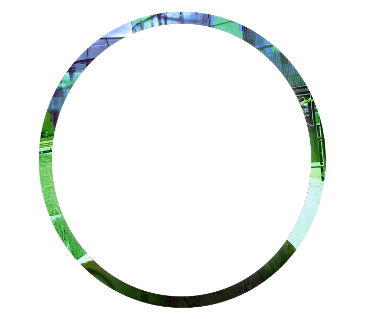

# **Contactos**

---

## Portal de Colecciones Centroamericanas de Biodiversidad

---

## Samanta Orellana 
[_ORCID_](https://orcid.org/0000-0002-4098-5823) | [_Bionomia_](https://bionomia.net/0000-0002-4098-5823)

Mentora y coordinadora del Portal de Colecciones de Centroamérica. Bióloga y entomóloga guatemalteca. Como parte del [equipo Symbiota](https://symbiota.org/about-us/) y la [red de GBIF](https://www.gbif.org/mentors), colabora activamente con colecciones latinoamericanas para avanzar sus iniciativas de datos de biodiversidad.

---

## Maura Quezada
[_ORCID_](https://orcid.org/0000-0002-8982-4350) | [_Bionomia_](https://bionomia.net/0000-0002-8982-4350)

Curadora del Herbario USCG del Centro de Estudios Conservacionistas (CECON), Universidad de San Carlos de Guatemala. Ha coordinado la digitalización de más de 20,000 especímenes botánicos desde el [Portal de Biodiversidad de Guatemala](https://biodiversidad.gt). Lidera el Proyecto BID-REG2025-81 desde Guatemala. 

---

## Dora Armero
[_ORCID_](https://orcid.org/0009-0004-5485-5183)

Curadora de la Colección de Aves y Secretaria Académica de la Escuela de Biología, Universidad de El Salvador.

---

## Gabriel Cerén
[_ORCID_](https://orcid.org/0000-0003-1234-1374)

Curador del Herbario ITIC en la Universidad de El Salvador. 

---

## Monika Springer
[_ORCID_](https://orcid.org/0000-0003-0926-1322)

Coordinadora del Centro de Investigación en Biodiversidad y Ecología Tropical (CIBET), Universidad de Costa Rica. Curadora de la Colección de Entomología Acuática en el CIBET.

---

## Mario Blanco
[_ORCID_](https://orcid.org/0000-0001-7369-5411)

Curador Herbario Luis A. Fournier Origgi, Centro de Investigación en Biodiversidad y Ecología Tropical (CIBET), Universidad de Costa Rica. 

